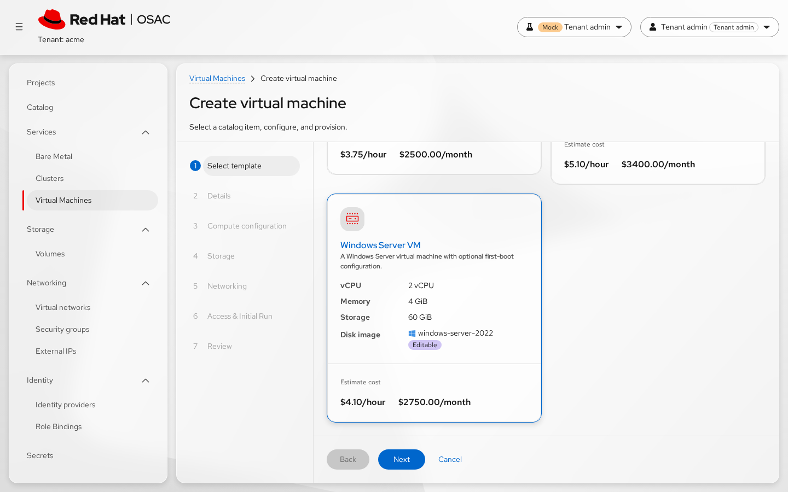
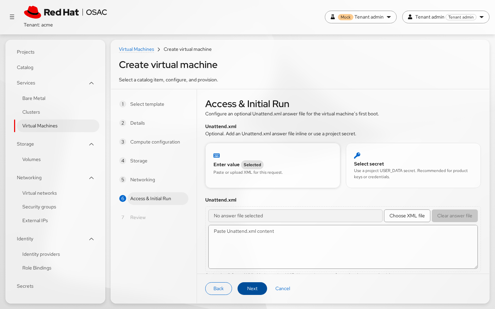
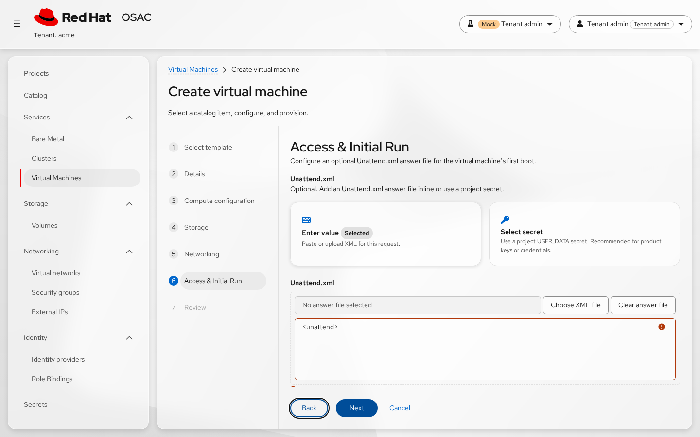
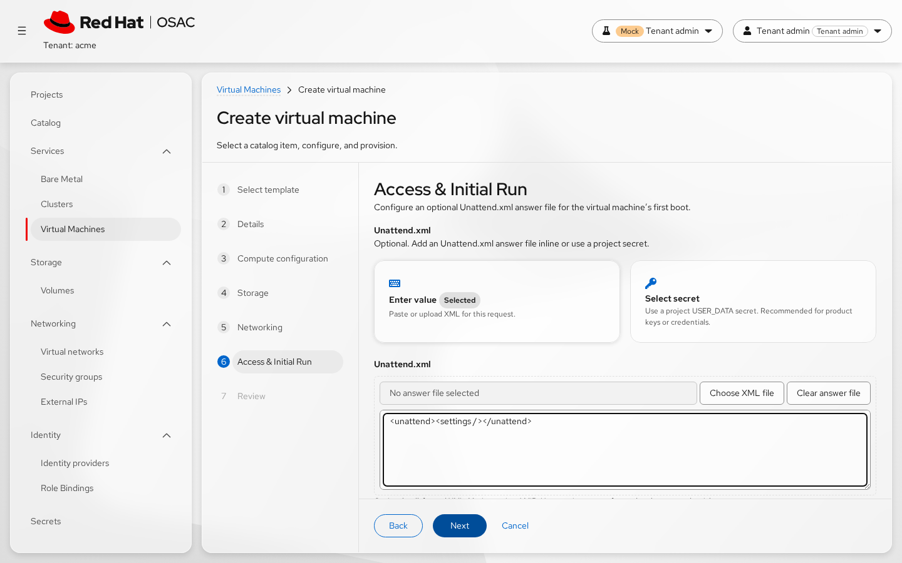
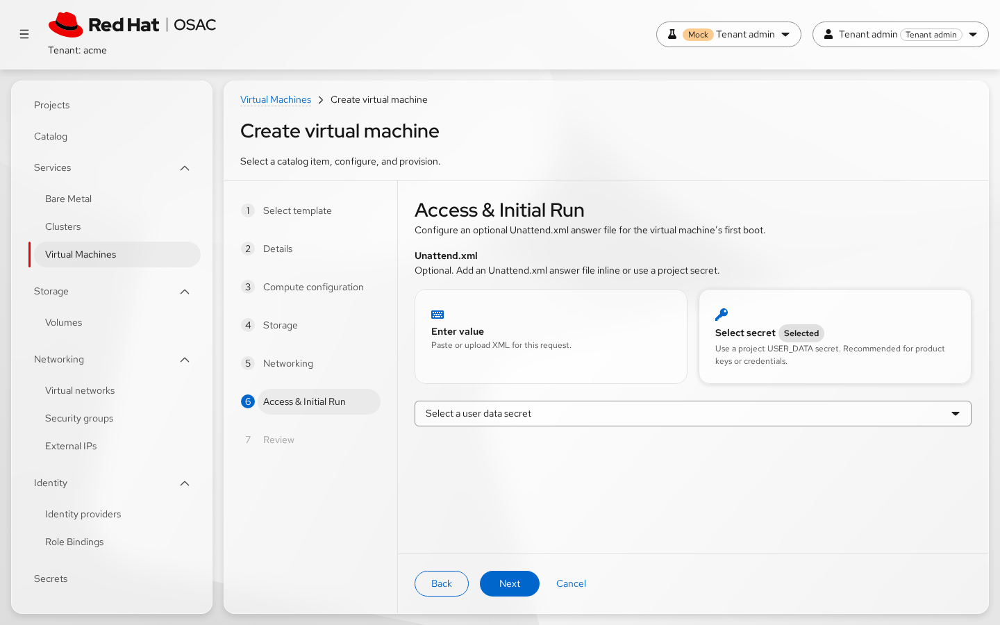
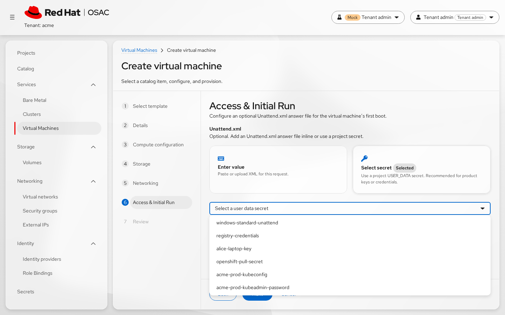
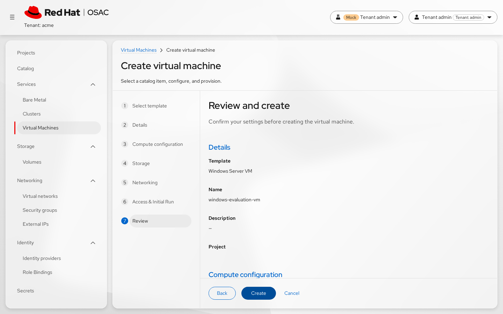
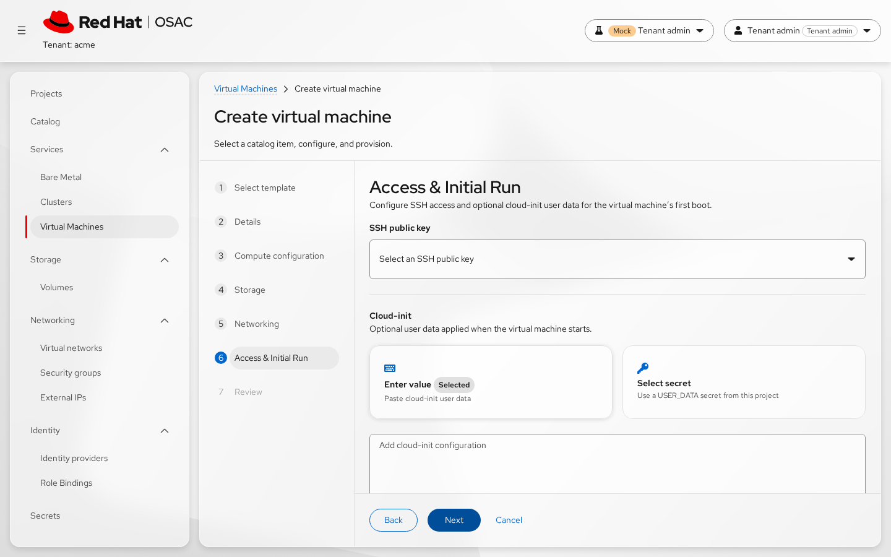

# Implementation Handoff — OSAC-4705

**Date:** 2026-11-03
**Feature key:** OSAC-4705
**UX story key:** OSAC-5009
**Context revision:** 2
**Prototype iteration:** 3
**Evaluation cycles:** 2
**Design system:** PatternFly 6
**Status:** Draft for researcher review

## Summary

This feature adapts the existing VM creation user-data control to the selected
guest OS. Tenant users can optionally paste or upload Windows `Unattend.xml`,
select a project-scoped `USER_DATA` Secret, or create a Windows VM without an
answer file; Linux retains the existing Cloud-init and SSH flow. The design
keeps inline content out of Review, recommends Secrets for sensitive content,
and hides SSH controls for Windows. Confidence is MEDIUM: the prototype and
evaluation are aligned, but formal user research, automated accessibility
scanning, and the final API/size-limit contract are unavailable or unresolved.

## Component Mapping

| # | UI Element | Component | Variants/Props | Notes |
|---|---|---|---|---|
| 1 | VM creation wizard shell | PatternFly `Wizard` in `CatalogProvisionWizard` | `isVisitRequired`; accessible navigation label; `WizardStep`; `WizardFooterWrapper` | Existing multi-step flow. Footer exposes Back, Next/Create, and Cancel. |
| 2 | Guest OS and disk-image selection | PatternFly `Gallery`, selectable `Card`, `ResourceSelectField` | Radio semantics; selected state; filtered disk-image request by guest OS family | The selected DiskImage supplies `guestOsFamily` before Access. |
| 3 | Access-step heading and guidance | PatternFly `Title`, `Content`, `Stack` | `headingLevel="h1"`; adaptive copy | Windows names the optional Unattend.xml answer file; Linux names SSH and Cloud-init; unspecified OS uses generic copy. |
| 4 | User-data source introduction | PatternFly `Stack`/`StackItem` and translated text | Adaptive title and description | One control adapts to guest OS; Windows recommends a project Secret for product keys or credentials. |
| 5 | Inline-versus-Secret choice | PatternFly `Card`, `CardBody`, `Stack`, `Label` | `role="radiogroup"`; cards use `role="radio"`, `aria-checked`, selected label, Enter/Space activation | Current Windows inline card title is still “Enter value” although the path supports paste and upload; retain as an open wording issue unless separately authorized. |
| 6 | Windows inline answer-file input | PatternFly `FileUpload` inside `FormGroup` | Text editing; browse/clear buttons; XML accept filter; `validated="error"`; `aria-invalid`; `aria-describedby` | Paste or select an XML file. Prototype keeps content in Formik memory, shows a 1 MiB guard, and performs client-side well-formedness feedback. Server validation remains authoritative. |
| 7 | Project Secret selector | Existing `SecretSelectionField` / `ResourceSelectField` | Project and `USER_DATA` type filter; placeholder; loading/error/empty states | Shows a reference only; never renders Secret content. |
| 8 | SSH public-key selector | Existing `ResourceSelectField` | Project and SSH-public-key filter; optional/locked behavior | Render for Linux and unspecified guest OS; omit for Windows in Access and Review. |
| 9 | Review summary | PatternFly `DescriptionList`, `DescriptionListGroup`, `DescriptionListTerm`, `DescriptionListDescription` | Adaptive payload label; masked inline value; Secret reference; no-answer state | Windows uses `Unattend.xml` and `No answer file`; Linux uses `Cloud-init`; inline content is masked. |
| 10 | Async and validation feedback | PatternFly `Spinner` and inline `Alert` | Loading state; warning/error variants; translated titles | Review loads instance type and project data. Wizard-level validation and provisioning errors remain visible without clearing form values. |

## State Matrix

| Component | Empty | Loading | Error | Populated | Partial | Responsive |
|---|---|---|---|---|---|---|
| Wizard shell | No catalog item selected; show Catalog step | Catalog data or step-specific data pending | Inline validation/provisioning alert; preserve values | Normal ordered VM steps | Review may render with one auxiliary query failed | PatternFly Wizard and footer remain usable; footer wraps controls as needed. |
| Guest OS and image selection | No family/image; no adaptive format claim | Disk-image list or filtered list pending | Resource-select load error/empty state | Selected family and image drive later copy | Image selected while family lookup is unresolved; use generic user-data wording | Guest-family cards wrap; image selector remains accessible at narrow widths. |
| Source cards | Source choice has no payload yet; inline is the prototype default | No independent loading state; parent data state applies | Selection/field error is shown by the surrounding form | Inline or Secret card selected and marked | Source selected while its child editor or selector is still resolving | Two columns above the prototype breakpoint; one column at `max-width: 768px`. |
| Windows inline `FileUpload` | Empty textarea, XML-file placeholder, optional helper | Prototype has no explicit progress state while reading a file; implementation must decide whether to disable or expose busy state | Oversize, unreadable file, or malformed XML; retain entered content when available and associate error with the field | Pasted or uploaded content is editable; selected filename may be shown | File read or validation pending; do not lose existing text | Textarea and browse/clear actions remain usable without horizontal overflow. |
| Project Secret selector | Placeholder, no Secret selected | Secret list query pending | Query failure or no matching project `USER_DATA` Secret | Selected Secret reference | Reference selected but refreshed list is unavailable; preserve reference and expose the query problem | Combobox/menu remains keyboard and screen-reader usable. |
| SSH selector | No key selected where optional | Secret list query pending | Query failure or empty list | Selected project SSH key | Not applicable/hidden for Windows | Existing resource-select responsive behavior. |
| Review summary | Windows with no payload shows `No answer file`; Linux/unknown uses the corresponding empty value | Spinner while instance type or project data loads | Inline warning for failed auxiliary query; provisioning error is shown at wizard level | All sections and payload state render | One auxiliary review query succeeds while another fails; keep the rest of the summary visible | Description lists stack naturally; long names and masked values must not force horizontal scrolling. |

## Interaction Specs

### User Flows

The screenshots below are representative visual states from the active
prototype evaluation (iteration 3). They document the interaction states, but
do not replace implementation verification for keyboard navigation, focus
management, or server-side behavior.

1. The tenant user selects Microsoft Windows and a Windows DiskImage in the
   Catalog/Compute flow. The selected image's guest OS family drives the
   Access-step copy.

   
2. On Access & Initial Run, Windows shows the optional Unattend.xml guidance,
   hides SSH public-key selection, and presents inline versus project Secret
   sources.

   
3. For the inline path, the user pastes XML or chooses an XML file. The file
   content is loaded into the editable field in memory. The prototype shows
   malformed-XML and size feedback without exposing the content in Review.

   

   
4. For the Secret path, the user selects a project-scoped `USER_DATA` Secret.
   The UI displays the selected reference and does not display the Secret
   value.

   

   

   
5. For the no-answer-file path, the user leaves the optional content empty.
   Review identifies the Windows state as `No answer file`.

   

   
6. The user advances to Review and confirms the adaptive payload label,
   masked inline state or Secret reference, and the absence of an SSH row for
   Windows. Create submits the unchanged create-time choice.

   

   
7. For Linux, the same journey retains SSH selection and Cloud-init wording.
   For an unspecified guest OS, the UI uses generic `User data` wording.

   

   
8. If a create-time validation or provisioning error is returned, the wizard
   shows an actionable error without clearing form values. Secret content must
   not appear in the error.

   *No create-time failure screenshot was captured; verify this behavior in the
   production implementation.*

### Transitions and Progressive Disclosure

- Changing the selected DiskImage changes the guest-OS-specific copy when the
  family is available; an unresolved family falls back to generic wording.
  Screenshot: 
  Screenshot: 
- Selecting a source reveals only its child control: the inline editor or the
  Secret selector.
  Screenshot: 
  Screenshot: 
- File selection is asynchronous and transitions to editable text plus a
  filename when successful. Clear returns to the empty inline state.
  Screenshot: 
- Next moves through the existing PatternFly Wizard. Create enters a pending
  state and returns to the same form with an error if provisioning fails.
  Screenshot: 
- No animation or automatic route transition beyond the existing Wizard flow
  is specified.

The evaluation did not capture keyboard-only or focus-transition screenshots;
the keyboard and focus requirements below remain implementation verification
items.

### Keyboard Navigation

- Follow PatternFly Wizard keyboard behavior for step navigation and footer
  controls; Back, Next/Create, and Cancel must be reachable in logical order.
- Guest-OS and source cards are keyboard focusable. The prototype activates a
  card with Enter or Space and exposes radio state with `aria-checked`.
  Arrow-key behavior is not specified by the prototype and should be aligned
  with the final radio-group implementation.
- The FileUpload browse button is activated with the keyboard; its textarea
  supports normal editing, paste, and blur validation. Clear is a keyboard-
  reachable action.
- The Secret selector follows the existing accessible combobox/listbox
  behavior. No feature-specific shortcuts are defined.
- Escape follows the existing wizard behavior: with unsaved progress it opens
  the discard confirmation; with no pending operation it may close directly.

### Focus Management

- PatternFly Wizard should move focus to the active step when the user moves
  between steps; verify this in implementation because the prototype review
  did not audit keyboard behavior.
- Field errors remain associated with the focused field through
  `aria-invalid` and `aria-describedby`. Error announcements/live-region
  behavior must be verified in the production implementation.
- After a file is cleared or rejected, keep focus in or adjacent to the inline
  editor so the user can recover without restarting the flow.
- The cancel confirmation is a modal: trap focus while open and return focus
  to the cancel trigger when dismissed. The discard action closes the wizard;
  Keep editing returns to the wizard without clearing values.
- On create failure, focus or an equivalent announcement must bring the
  provisioning error to the user's attention while preserving entered values.

## Data Annotations

The following annotations use conceptual sources only. Concrete endpoint names
and schema details remain the responsibility of `ui-design` unless already
verified in the discovery/design sources.

| UI Element | Data Needed | Source Type | Notes / Gaps |
|---|---|---|---|
| Guest OS selector | Available guest OS families and selected family | API | Derived from the DiskImage catalog and form selection. |
| Disk-image selector | Available images, display names, guest OS family, availability | API | Must be available before Access so copy and SSH visibility are correct. |
| Wizard labels and helper text | Step names, translated labels, guidance, button text | Static | Use existing translation infrastructure; do not hardcode new unextractable strings. |
| Source choice cards | Current source (`inline` or `secret`) and selected state | User input / Computed | The source choice is user input; selected styling is computed from form state. |
| Windows inline editor | Pasted text or selected file contents; filename; error state | User input | Content must remain in active form state only. File contents are read client-side; no browser persistence. |
| Windows XML feedback | Size and well-formedness result | Computed / API | Client feedback is prototype behavior; server validation is authoritative. Exact server error shape is unknown. |
| Project Secret selector | Project-scoped `USER_DATA` Secret references and selected reference | API / User input | The list is API data filtered conceptually by current project and Secret type; only the reference is displayable. |
| SSH selector | Project-scoped SSH public-key references and selected key | API / User input | Not rendered for Windows. Existing selector owns loading, empty, and error states. |
| Access guidance | Selected guest OS family and source choice | Computed / Static | Copy must not claim Windows XML semantics when the family is unresolved. |
| Review template/project/name | Catalog item, project, VM name, description | API / User input | Review combines loaded catalog/project data with current form values. |
| Review compute/storage/network sections | Disk image, instance type, disks, storage tiers, networks | API / User input | Existing review data; only Access payload and SSH rows are feature-specific. |
| Review payload state | Inline-present, Secret reference, or no answer file | Computed | Never render inline payload bytes. Final serialized field remains unresolved between existing user-data fields and `unattend_xml`. |
| Wizard loading/errors | Query status, validation errors, create/provisioning result | Computed / API | Preserve form values; secret content must not appear in errors. |
| Response privacy behavior | Cache-control and response exposure for inline data | API / Configuration | Backend requirement from PRD/design; not verifiable from the prototype. |

UI states that depend on backend behavior and must be validated during
implementation: final field serialization, server XML validation, agreed
payload limit, no-store response handling, Secret snapshot behavior, and the
exact sysprep key used by the deployed KubeVirt version.

## Persona-Specific Views

Formal research was not run. These views use the user groups in discovery and
the prototype journeys.

| User Group | Distinct Views or Actions | Permission Notes |
|---|---|---|
| Tenant User | Shared VM create flow; inline paste/upload, optional no-answer path, Linux Cloud-init continuity; Windows SSH is omitted. | Must only see resources available to the current project/tenant. |
| Tenant Admin | Same create flow, with stronger guidance toward a project `USER_DATA` Secret for product keys or credentials; can reuse a project Secret when available. | Secret selection is project-scoped. Do not invent a permission name; rely on the confirmed existing project authorization model. |
| Cloud Provider Admin | No distinct tenant-facing view in this feature. Their concerns are catalog/image metadata, guest-OS correctness, validation, and tenant-safe Secret behavior. | Administrative controls are outside this UI scope. |
| Cloud Infrastructure Admin | No UI changes; this role operates the provisioning path after the create request. | Not affected by the requested UI flow. |

Tenant User and Tenant Admin share the same components and navigation. Their
primary distinction is the recommended delivery method, not a different screen
or interaction model.

## Accessibility Requirements

- **Wizard:** Use the existing PatternFly Wizard navigation semantics and
  accessible navigation label. Keep the active-step focus behavior and footer
  order intact. Announce validation and provisioning errors.
- **Guest OS and source cards:** Preserve visible selected state plus
  `role="radio"`, `aria-checked`, and a labelled group. The final source
  implementation must choose one consistent radio keyboard model (native
  radio behavior or a complete WAI-ARIA radio pattern); the prototype's
  Enter/Space support alone is not an accessibility audit.
- **Windows FileUpload:** Keep a programmatic label, helper description,
  invalid state, and browse/clear button names. Associate the error message
  with the textarea and browse control. Do not rely on color or the file icon
  alone to communicate state.
- **Secret selector and SSH selector:** Preserve accessible labels,
  placeholders, loading feedback, empty-state descriptions, and keyboard
  combobox/listbox behavior from the existing resource selectors.
- **Review:** Keep semantic description-list terms and descriptions. Masked
  values must still have meaningful accessible text such as “Provided” rather
  than exposing the content.
- **Alerts and async states:** Inline errors must be programmatically
  discoverable; loading states must not strand focus. The current evaluation
  found no visual accessibility blocker, but keyboard order, screen-reader
  announcements, WCAG conformance, and automated scanning were not audited.
- **NFR reconciliation:** The published PRD/design has no numbered NFRs. Its
  binding accessibility/privacy constraints are carried here; no browser
  support or performance constraint was specified, so those remain unverified.

## Acceptance Criteria

AC-1: Guest-OS-aware user-data guidance
  Given a DiskImage with a known guest OS family
  When the user reaches Access & Initial Run
  Then Windows shows Unattend.xml guidance, Linux shows Cloud-init guidance,
  and an unspecified family uses generic User data guidance
  Trace: Discovery strategic decision; PRD; prototype iteration 3

AC-2: Windows inline input
  Given a Windows DiskImage and the inline source selected
  When the user pastes XML or chooses an XML file
  Then the content is editable in the inline control, XML files are accepted,
  and the current value remains available for correction
  Trace: OSAC-5009 constraint; prototype windows-inline and malformed-xml journeys

AC-3: Windows project Secret
  Given a Windows DiskImage and the Secret source selected
  When the project Secret list is opened
  Then only project-scoped USER_DATA Secrets are offered and the selected
  Secret value is never rendered in the form or Review
  Trace: PRD sensitive-content and project-scope requirements; prototype windows-secret journey

AC-4: Optional Windows answer file
  Given a Windows DiskImage and no inline value or Secret selected
  When the user reaches Review
  Then the payload row is labeled Unattend.xml and displays No answer file
  Trace: PRD no-answer-file story; prototype windows-no-answer-file journey

AC-5: Windows SSH omission
  Given a Windows DiskImage
  When the user views Access & Initial Run or Review
  Then no SSH public-key control or SSH review row is rendered
  Trace: OSAC-5009 constraint; prototype iteration 3; evaluation recheck

AC-6: Linux continuity
  Given a Linux DiskImage
  When the user views Access & Initial Run and Review
  Then SSH remains available, the user-data control uses Cloud-init wording,
  and the existing inline-versus-Secret interaction remains available
  Trace: PRD customization-parity goal; prototype linux-inline journey

AC-7: Recoverable inline validation feedback
  Given Windows inline content is malformed or rejected by a client-side
  guard
  When validation runs
  Then the field shows an actionable error, the entered content is retained
  when it was already loaded, and correcting the content clears the error
  Trace: Discovery recovery question; prototype EVL-5 recheck

AC-8: Review privacy treatment
  Given inline Windows or Linux content is present
  When the user views Review
  Then the payload state is represented without displaying the inline content
  Given a Secret source is selected
  When the user views Review
  Then only the Secret reference is displayed
  Trace: PRD sensitive-content requirements; prototype iteration 3

AC-9: Create-time error recovery
  Given the server rejects the create request
  When the error is shown
  Then the wizard retains the user's form values, presents an actionable
  error, and does not expose Secret content in the message
  Trace: PRD validation/failure handling; published design IC-1

AC-10: Responsive source selection
  Given the viewport is at or below the prototype's 768px breakpoint
  When the user views the source choices
  Then the two source cards stack into one column and remain individually
  keyboard and pointer accessible
  Trace: Prototype UserDataSourceCards responsive CSS

AC-11: Contract-gated Windows payload limit
  Given the implementation team has resolved the conflict between the
  OSAC-5009 1 MiB assumption and the published design's no-size-limit decision
  When a Windows inline payload crosses the agreed limit
  Then the UI and server enforce the same agreed behavior without storing the
  content in browser persistence
  Trace: Discovery reconciliation item; prototype 1 MiB guard; design OQ-1

AC-12: Sensitive content handling
  Given inline content is entered in the create wizard
  When the user navigates through the flow or abandons it
  Then the content is held only in active form state and is not written to
  local storage, session storage, browser cache, logs, or events by the UI
  Trace: PRD protection requirements; published design IC-4

## Feasibility and Phasing

The core adaptive interaction is supported by the current architecture: the
DiskImage exposes guest OS family, the UI already carries an inline-versus-
Secret source union, and the published design describes fulfillment validation,
snapshotting, and sysprep delivery. The items marked as backend work or
unverified below must be resolved before implementation is considered complete.

| Design Element | Support | Notes / Backend Requirement |
|---|---|---|
| Guest-OS-aware labels, guidance, and SSH visibility | Supported | Existing DiskImage guest OS family and current UI hook provide the required input. |
| Inline paste or XML upload into the existing source flow | Supported in prototype | The UI can keep file contents in active form state; final serialization must follow the resolved API contract. |
| Existing `user_data` / `user_data_secret` source union | Supported by published PRD/design | OSAC-5009 proposes a dedicated write-only `unattend_xml` field. The contract choice is unresolved; do not assume a new field. |
| Dedicated `unattend_xml` API field, if selected | Needs backend support | Not described by the published design; would require contract, validation, and UI serialization changes. |
| Windows well-formed XML validation | Needs backend support | Fulfillment must validate inline and resolved Secret content at create time without exposing Secret bytes. |
| Client-side malformed-XML feedback | Unverified against technical design | Prototype supports it, but published design makes server validation authoritative and leaves client validation optional. |
| Windows payload maximum | Requires a design change | Prototype/OSAC-5009 use 1 MiB; published design OQ-1 says no inline limit. Product and backend must agree before UI enforcement. |
| Project-scoped `USER_DATA` Secret selection | Supported | Existing filter and published tenancy model support the reference flow. |
| Secret snapshot and Windows sysprep delivery | Needs backend support | Fulfillment/operator/AAP work must snapshot validated bytes and mount the final KubeVirt sysprep volume. |
| Windows with no answer file | Needs backend support | Published design removes platform-generated sysprep behavior for this case; UI already represents `No answer file`. |
| Review masking and Secret-reference display | Supported in UI | Backend must also preserve no-store and response/event/log privacy requirements for inline data. |
| `Cache-Control: no-store` for inline user-data responses | Needs backend support | Cross-cutting response behavior is outside the prototype and UI-only implementation. |
| Exact KubeVirt sysprep key/version behavior | Unverified against technical design | Published design specifies `Unattend.xml`; current documentation examples also reference `autounattend.xml`. Verify deployed version. |
| Keyboard, screen-reader, and WCAG behavior | Unverified against technical design | Visual review found no blocker, but no keyboard audit, automated scan, or human usability test was run. |

### Final Vision

The complete intended UX is one guest-OS-aware create flow: Windows users can
paste or upload an optional Unattend.xml, select a project Secret, or omit the
answer file; Linux users retain Cloud-init and SSH; Review shows only safe
payload state; and server-side validation, snapshotting, privacy controls, and
sysprep delivery enforce the same contract end to end.

### MVP / Phase 1 (proposed)

Resolve the API field and payload-limit conflicts first, then implement the
full visible journey against the selected contract: adaptive guidance, inline
paste/upload held in memory, project Secret selection, no-answer-file state,
Windows SSH omission, masked Review, and recoverable create errors. The
backend work in the published design (Windows XML validation, snapshotting,
sysprep routing, and privacy headers) is part of the feature's implementation
boundary. No user journey is proposed for silent deferral; if the 1 MiB rule
is not accepted, the UI must remove the prototype's hard limit rather than
ship a contradictory client/server contract.

## Open Questions

1. **API contract:** Does Windows bind to the existing `user_data` /
   `user_data_secret` union from the published PRD/design, or does the linked
   UX work item require a dedicated write-only `unattend_xml` field? Do not
   finalize UI serialization until this is resolved.
2. **Payload limit:** OSAC-5009 and the prototype show a 1 MiB maximum, while
   the published design explicitly resolves OQ-1 as no inline size limit. The
   UI and server must share one confirmed rule.
3. **Client validation:** Confirm whether prototype malformed-XML feedback
   ships in the UI and define the server-error shape used for recovery.
4. **Inline card wording:** Evaluation revision 2 confirmed a Minor issue:
   “Enter value” does not expose the paste/upload affordance. No repair was
   authorized; decide whether implementation may rename it to “Paste or upload”
   or equivalent.
5. **Radio keyboard model:** Confirm whether source cards should support arrow
   navigation and roving tabindex in addition to Enter/Space.
6. **Browser support and accessibility verification:** No automated
   accessibility scan or real user testing was conducted. Confirm supported
   browsers and run keyboard/screen-reader verification before release.
7. **Backend boundaries:** Confirm no-store handling for responses containing
   inline user data, exact server XML validation messages, Secret snapshot
   semantics, and the version-specific KubeVirt sysprep key.

## Research Context

- **Discovery:** `01-discovery.md` (context revision 2)
- **Research:** Not run; `02-research.md` is absent. Discovery supplied the
  evidence used for this handoff.
- **Prototype:** `03-prototype/` (iteration 3; reviewed against discovery
  revision 2)
- **Evaluation:** `04-evaluation.md` (evaluation revision 2; context revision
  2; Researcher review: Confirmed; Authorized fixes: None; Ready for handoff:
  Yes)
- **Evaluation method:** AI-simulated three-pass heuristic review of a live
  local render. It does not replace human usability testing or an automated
  accessibility audit.
